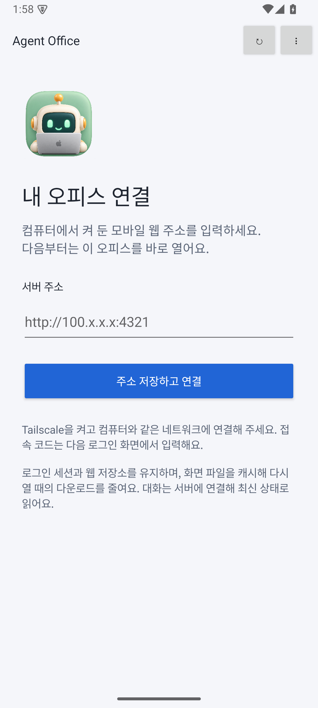
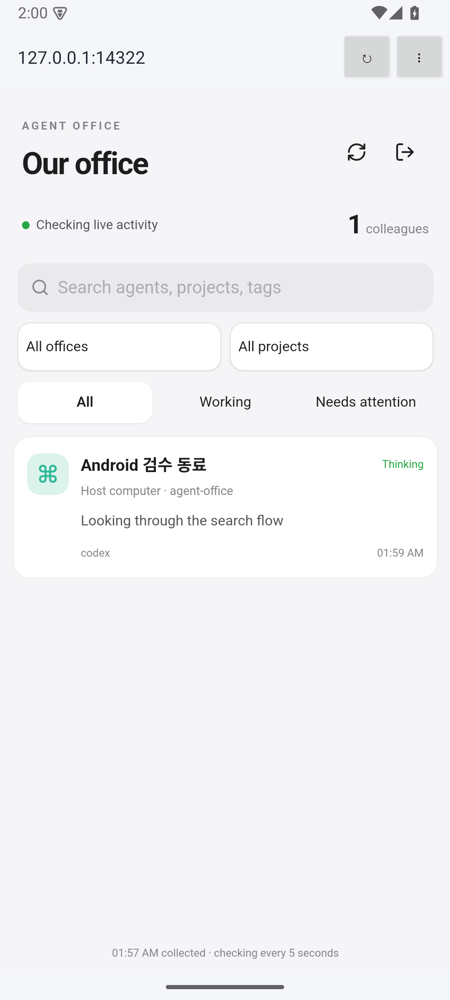

# Android 오피스 클라이언트

`android/`는 기존 [모바일 웹](MOBILE-WEB.md)을 여는 작은 Android 앱이다. Android 8 이상, 앱 ID `dev.kys.agentoffice.mobile`. 서버나 에이전트를 휴대폰에서 실행하지 않는다. 컴퓨터의 오피스와 모바일 웹 서버가 실행 중이어야 하며 HTTP Tailscale 주소에는 휴대폰의 Tailscale 연결이 필요하다.

## 사용

1. APK를 설치하고 모바일 웹의 주소(`http://100.x.x.x:4321`)를 저장한다. HTTPS 서버도 지정할 수 있다. 주소에 접속 코드를 넣지 않는다.
2. 기존 웹 로그인 화면에서 접속 코드를 입력한다. 주소와 WebView 쿠키·DOM 저장소를 유지해 다음 실행에서 바로 연다. 서버의 로그인 만료(최대 12시간), 재시작·코드 변경에 따른 재로그인은 그대로 적용된다.
3. 앱 상단 메뉴에서 주소 변경, 최종응답 알림 켜기/끄기, 로컬 데이터 삭제를 사용한다. 주소 변경·삭제 시 이전 쿠키·웹 저장소·캐시·알림 상태를 정리한다. 서버 데이터는 변경하지 않는다.

초안과 미확인 전송의 수명은 웹의 sessionStorage 계약을 따른다. 프로세스를 완전히 종료한 뒤의 초안 복원을 보장하지 않는다. 네트워크 복귀 시 메시지를 자동 재전송하지 않는다.

## 실행과 저장 경계

WebView는 현재 서버 origin만 앱 안에서 열고 외부 HTTP(S) 링크는 사용자가 누를 때 외부 브라우저로 연다. 파일·content 접근, 제3자 쿠키, 혼합 콘텐츠, 지리/미디어 권한, 네이티브 JavaScript 인터페이스는 제공하지 않는다. TLS 오류를 무시하지 않으며 native API 요청은 리디렉션을 따르지 않는다. 평문 HTTP는 숫자 Tailscale IPv4 및 기기 loopback만 받는다. 자격증명·쿼리·경로가 들어간 주소는 저장하지 않는다.

Android는 일반 HTTP를 위해 manifest cleartext를 허용하지만 앱 입력/탐색/요청 계층에서 위 경계를 다시 강제한다. 접속 코드는 APK·SharedPreferences에 저장하지 않는다. WebView의 HttpOnly 쿠키만 native 조회가 함께 사용한다. 백업과 기기 간 데이터 이전을 제외한다.

캐시는 동일 origin의 해시가 붙은 JS/CSS/폰트 파일만 포함한다. 파일당 4 MiB, 전체 64 MiB의 LRU이며 origin별 키로 격리한다. 서버가 개인정보 보호를 위해 전역 no-store를 쓰더라도 이 공개 정적 자산만 네이티브 캐시에 명시적으로 보관한다. HTML은 매번 서버에서 받으므로 배포 후 새 해시를 찾는다. API·로그인·대화 원문·알림 본문을 디스크 캐시하지 않는다. 오프라인 대화 열람 기능이 아니다. 주소 변경/로컬 데이터 삭제 시 캐시도 지운다.

## 최종응답 알림

기본 꺼짐이다. 사용자가 켜고 Android 알림 권한을 허용해야 동작한다. 기존 `/mobile/api/state`, `/mobile/api/detail`을 읽기만 하며 서버 변경이 필요 없다. 공개 assistant 이벤트의 명시적 `phase=final`만 대상으로 삼는다. 최초 로그인/알림 활성화의 서버 시각을 기준으로 과거 응답 알림을 막고, 세션별 마지막 시각·같은 시각의 이벤트 ID로 중복을 막는다. 원문은 저장하지 않는다. 잠금화면을 고려해 알림은 동료 이름/응답 전문 없이 일반 문구만 표시하고 오피스를 연다.

- 앱 표시 중 15초마다 최대 6개 대화를 순환 확인한다.
- 백그라운드는 Android JobScheduler의 15분 이상 주기 작업으로 최대 24개씩 순환 확인한다. 요청에 40초 실행 예산을 두므로 서버 지연·대화 수·절전/Doze·네트워크에 따라 더 늦어지거나 최근 페이지 밖의 응답을 놓칠 수 있다. 즉시 푸시나 완전한 응답 보관함이 아니다.
- 로그인 만료/서버 종료 시 전송이나 재로그인을 자동 시도하지 않는다. 앱에서 로그인한 뒤 새 기준으로 확인한다. 개인정보 가림은 알림을 비우며 현재 가시 범위와 서버 상세 권한을 따른다.
- 알림 끄기는 예약 작업을 취소한다. OS 강제 종료 중에는 Android 정책에 따라 다시 앱을 열 때까지 작업이 멈춘다.

공식 계약: [WebView 설정](https://developer.android.com/reference/android/webkit/WebSettings), [주기 작업](https://developer.android.com/reference/android/app/job/JobInfo.Builder#setPeriodic(long)), [알림 권한](https://developer.android.com/develop/ui/views/notifications/notification-permission).

## 빌드·서명

JDK 17, Android SDK 35/build-tools 35, Gradle wrapper 8.13 및 AGP 8.13을 사용한다. 빌드 도구는 저장소 밖에 설치한다.

```sh
cd android
./gradlew testDebugUnitTest lintDebug assembleDebug
```

`app/build/outputs/apk/debug/app-debug.apk`는 개발 검수용이다. 전달 release는 아래 환경 변수로 별도 보존 키를 공급한다. 키/비밀번호는 저장소·로그·공유 폴더에 넣지 않는다. 같은 앱 업데이트에는 같은 키와 증가된 versionCode가 필요하다.

```sh
# AO_ANDROID_KEYSTORE / AO_ANDROID_STORE_PASSWORD / AO_ANDROID_KEY_ALIAS / AO_ANDROID_KEY_PASSWORD
./gradlew assembleRelease
# SDK build-tools의 apksigner verify --verbose --print-certs <apk>
```

Android CI는 관련 경로가 바뀔 때 Linux에서 단위·Lint·debug APK를 검사한다. Play Store 배포/자동 업데이트/FCM은 포함하지 않는다.

## 검증

`ServerAddressTest`, `ReplyCursorTest`는 origin·캐시 경계, 명시적 최종응답·이전 응답/재실행 중복 방지를 검사한다. `SmokeInstrumentation`은 에뮬레이터와 합성 웹 서버만 사용해 저장·로그인·reload·DOM 저장소·정적 캐시·최종응답 알림·중복·끄기를 확인한다.

```sh
npm ci
npm run build
npx tsx scripts/android-fixture.ts
# 다른 터미널, 에뮬레이터를 켠 후:
adb reverse tcp:14322 tcp:14322
adb reverse tcp:14323 tcp:14323
cd android
./gradlew assembleDebug assembleDebugAndroidTest
adb install -r app/build/outputs/apk/debug/app-debug.apk
adb install -r app/build/outputs/apk/androidTest/debug/app-debug-androidTest.apk
adb shell pm grant dev.kys.agentoffice.mobile android.permission.POST_NOTIFICATIONS
adb shell am instrument -w dev.kys.agentoffice.mobile.test/dev.kys.agentoffice.mobile.SmokeInstrumentation
```

실제 서버 접근 코드·개인 대화는 검수 fixture에 복제하지 않는다. 에뮬레이터 검증은 실제 휴대폰/OEM 절전 정책과 별도로 기록한다. 합성 서버와 에뮬레이터는 검수가 끝나면 중지한다.

## 2026-10-19 검수 근거

API35 arm64 Pixel 7 에뮬레이터에서 실제 모바일 웹 서버 + 합성 세션으로 로그인, reload/Activity 재시작 시 쿠키·localStorage 유지, 공개 자산 캐시, 과거 final 무알림, 새 final 1회 알림, 중복 억제, opt-out 작업 취소, 로그아웃 정리를 확인했다. 합성 전송 횟수는 0이며 개인 서버에 테스트 메시지를 보내지 않았다. Android 네이티브 select 높이 차이로 잘리던 필터는 앱에서 최소 높이·수직 패딩을 보정한다.



