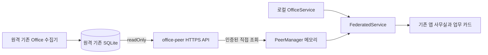

# 여러 Office 연결 베타

같은 데스크톱 앱에서 여러 컴퓨터의 관측 결과를 모아 본다. 기본값은 꺼짐이며, 설정의 **여러 사무실 연결 베타**에서 켠다. 중앙 동기화 서버나 계정은 없다. 컴퓨터별 사무실 안에 프로젝트 구역을 유지하며, 별도 권한이 있는 연결은 기존 로컬 전송 가능 에이전트에 메시지를 보낼 수 있다.

## 경계와 데이터 흐름



- `server/federation/`이 별도 API·프로토콜·클라이언트·합성 계층이다. 기존 `/api/rpc`, MCP, `OfficeService` 저장 흐름은 그대로다. 조회 API는 GET `/office/v1/snapshot`, `/office/v1/detail`이다. 별도 command token을 요구하는 POST `/office/v1/commands/targets`, `/office/v1/commands/send`를 추가한다.
- 송신기는 기존 SQLite를 readOnly로 열며 수집기, migration, seat 할당, 사용자 설정 쓰기를 실행하지 않는다. 기존 Office가 수집한 가시 세션과 명시한 프로젝트 범위의 교집합만 제공한다.
- 수신기는 원격 내용을 기존 SQLite에 쓰지 않는다. `federation-beta/peers.json`에 연결 설정만 저장한다. 원격 스냅샷·상세는 메모리에만 있고 앱 종료 시 사라진다. 베타를 끄면 요청/타이머/캐시를 폐기하고 기존 로컬 스냅샷으로 복귀한다. 송신 프로세스는 별도로 중지해야 한다.
- `officeId + 원격 ID의 SHA-256`으로 세션·부모·배우·이벤트·workspace ID를 격리한다. 다른 컴퓨터의 같은 원본 ID도 충돌하지 않는다. 원격 절대 경로·별명·메모·개인 핀·읽음 상태·공급자 인증 정보는 DTO에서 제외한다. **제목, 프로젝트, 활동 발췌, 대화 본문에는 사용자가 쓴 경로나 민감한 글이 포함될 수 있다. 본문 익명화 기능은 아니다.**
- 사이드바에서 컴퓨터별 사무실을 전환한다. 각 사무실은 프로젝트 구역, 사무실/대기/보관 공간과 집계를 따로 가진다. 연결의 이름·태그로 컴퓨터를 구분한다. 프로젝트 대응표 `원격 프로젝트 = 표시 그룹`은 해당 원격 사무실 안에서만 묶는다. 로컬 구역/규칙/DB는 변경하지 않는다. 개인정보 숨김은 컴퓨터 이름·태그도 가린다.
- 조회 전용 연결에는 채팅 입력창이 없다. 별도 채팅 권한 연결만 기존 실행 중 에이전트에 메시지를 보낸다. 원격 터미널 이동·resume·answer·notes·pin·가리기·북마크·인수인계는 지원하지 않는다. 렌더러에서 버튼을 숨기는 것과 별도로 IPC/service에서도 remote ID를 거절한다. 로컬 전문 검색·소식·MCP에는 원격 기록이 포함되지 않는다.

## 로컬 전용 사용과 호환성

- 기본 꺼짐에서는 기존 로컬 snapshot/patch와 RPC 결과를 그대로 전달하고 peer 요청·주기 타이머·연결 설정 파일을 생성하지 않는다. 베타를 켜도 연결이 없으면 원격 요청은 없다.
- 기존 DB 스키마·데이터 경로·프로젝트 구역·설정을 이 기능 때문에 이관하지 않는다. 로컬 메모·별명·검색어·프로젝트 이름은 원격 ID와 같은 문자열을 포함해도 그대로 처리한다. 원격 쓰기 차단은 실제 ID 인자·필터·세션 규칙에만 적용한다.
- 공통 Codex Desktop 전송은 베타 설정과 독립적인 추가 기능이다. 기존 Codex CLI 큐·Claude 전송을 유지하며 Desktop IPC 미지원은 해당 Desktop 대상만 전송 불가로 처리한다. 모든 Codex 버전·OS의 Desktop 전송 호환성을 보장하지 않는다.
- 수신 베타를 끄면 기존 로컬 화면으로 복귀하지만, 별도로 실행한 exporter 서버까지 종료하지는 않는다. 원격 공개를 중지하려면 exporter를 별도로 종료하거나 공유 설정을 비활성화한다.

## 연결과 권한

TLS 자체 서명 인증서의 SHA-256 지문과 256-bit bearer token을 `connection.json`으로 전달한다. 이 파일은 비밀이며 SSH/SCP 등 이미 신뢰한 경로로 전달한다. 인증서 지문과 유효기간을 확인한 **후** HTTP 토큰을 보낸다. 자동 발견·TOFU·브라우저 CORS·리디렉션은 없다. 인증서 변경 시 파일을 새로 전달하고 연결을 다시 등록한다.

설정 디렉터리는 0700, token/키 파일은 0600이다. 송신기는 매 요청마다 설정과 공유 범위를 다시 읽는다. `export.json`의 `enabled: false`, token 교체, 프로젝트 축소가 다음 요청부터 적용된다. 클라이언트의 권한/인증서/프로토콜 오류는 해당 캐시를 제거한다. 일반 네트워크 장애는 마지막 정상 관측에 연결 끊김을 표시하고 최대 24시간 유지하며, 일하는 중/주의 필요 집계에서 제외한다.

조회는 연결당 5초 간격이고 실패 시 최대 60초까지 늘린다. 요청 제한 5초, 응답 16 MiB, Office당 900 세션, 최대 5개 연결이다. `epoch/version`이 같으면 변경 없음 응답, 변경되면 전체 bounded snapshot을 받는다. 원격 delta 전송은 아직 없다. 기존 데스크톱 snapshot/patch 구독은 그대로 쓴다.

수신 시각은 네트워크 조회 성공 시각이다. 원격 수집기가 살아 있다는 heartbeat가 아니며 기존 관측 시각·상태 파생 규칙을 함께 해석한다. `paused`는 stale로 표시한다. 상세는 최근 최대 180개, 이벤트당 64,000자이고 잘린 경우 partial이다. 이전 대화 페이지는 지원하지 않는다.

## 전송량과 오래 실행할 때의 보관량

- 목록의 최근 4개 발췌는 사용자 요청·공개 진행 메시지·최종 답변만 포함한다. 도구 본문은 제외하고 별도 활동 요약/상태는 유지한다.
- 같은 epoch/version의 heartbeat는 수신 시각만 갱신하며 세션 전체를 다시 만들거나 매번 change를 발행하지 않는다. 연결·일시정지·대화 권한이 달라지면 즉시 반영한다. 세션의 `remote.receivedAt`은 마지막 내용 교체 시각이고 연결 상태의 `receivedAt`은 마지막 정상 확인 시각이다.
- 상세는 `view=conversation|all`, `limit=1..180`을 선택할 수 있다. 생략 시 기존 전체/180개를 유지한다. `conversation`은 사용자/assistant 메시지만 먼저 고른다. `since=SHA256(전체 wire session JSON)`가 같으면 `{officeId, unchanged: true, revision}`만 반환한다. 현재 인증·프로젝트·대화 공유 권한 검사는 캐시 응답에도 항상 적용한다.
- 수신 상세 캐시는 epoch·세션·보기·개수별 최신 응답만 보관하며 최대 16항목, JSON UTF-8 크기 합계 4MiB, 마지막 저장 후 60초다. 조회와 peer polling에서 만료를 제거하고 연결 설정 변경/기능 종료/권한 거절 때 비운다. 실제 객체 힙 크기는 JSON 바이트 수보다 클 수 있다.
- 새 수신기는 구 exporter의 전체 응답도 수용한다. 새 exporter는 `since` 없는 구 수신기에 기존 응답 형태를 유지한다. 구 exporter에 연결하면 조건부 응답/서버 필터에 따른 네트워크 절감은 적용되지 않는다. 기존 Desktop 기본 원격 상세 창은 180개를 유지한다.
- source SQLite의 조회/파싱과 응답 해시 계산은 계속 필요하다. 이 변경은 네트워크 본문·수신 객체 재생성·보관량을 줄이며 무기한 실행의 전체 RSS 무증가를 보증하지 않는다. 검증은 합성 반복/상한 회귀 테스트이며 실제 장시간 RSS 프로파일링은 별도다.

## 실행

Node 24 이상, OpenSSL과 빌드가 필요하다. 같은 저장소의 번들 `dist-desktop/office-peer.cjs`를 사용한다. 송신할 컴퓨터에서는 기존 Office를 계속 실행한다.

```sh
npm run build
# 실제 LAN 인터페이스 주소와 별도 설정 경로 지정
npm run peer -- --init --host 192.168.1.20 --port 4320 \
  --project agent-office --conversation --config-dir /private/path/office-peer
npm run peer -- --serve --config-dir /private/path/office-peer \
  --data-dir "/path/to/existing/Agent Office"
```

`--all-visible`은 모든 가시 프로젝트를 명시적으로 공유한다. `--conversation`은 최근 대화 상세 조회를 허용한다. `--allow-send`를 초기화에 명시하면 조회 token과 다른 sendToken을 발급한다. 기존 연결에 채팅을 추가할 때는 export.json의 allowSend와 새 독립 sendToken을 설정하고 connection.json에도 그 sendToken을 반영해 다시 가져온다. 토큰을 셸 인수나 로그에 넣지 않는다. `--allow-send`에는 기존 앱의 terminal-send.json이 있는 정확한 `--profile-dir` 지정이 필수다. 데이터 경로와 프로필 경로가 다를 수 있으므로 추정하지 않는다. 이 옵션이 없어도 스냅샷에는 제목·활동·최근 4개 발췌가 들어간다. 상세 미허용 서버의 카드는 발췌만 표시한다. 공유 권한을 축소하면 열린 카드의 상세도 발췌로 초기화한다. 전체 대화 허용과 공유 프로젝트 범위를 먼저 선택한다. 초기화는 기존 export.json을 덮어쓰지 않는다.

수신할 컴퓨터에서 같은 앱의 설정 → 여러 사무실 연결 베타 켜기 → 전달받은 `connection.json` 가져오기를 누른다. 이름·태그·프로젝트 대응표는 로컬 연결 설정에 저장된다. 재등록하면 endpoint/token/인증서를 교체할 수 있다.

개발 중 기존 앱 데이터를 보존하려면 별도 worktree에서:

```sh
npm run build
npm run start:beta
```

동일 앱을 `.local/beta-preview/`의 별도 개발 프로필·DB·연결 설정으로 실행한다. 로컬 공급자 로그는 읽기만 하며, 원래 설치 앱·기존 DB·환경설정을 교체하지 않는다. 베타 기능 기본값은 이 프로필에서도 꺼짐이다. 기본 앱을 실행할 때는 평소와 같이 `npm start`이며, 기존 데이터를 읽고 쓰는 앱 동작 자체는 유지된다.

중지는 송신기 foreground의 Ctrl+C 또는 확인한 송신 프로세스의 SIGTERM이다. 수신 설정의 베타 끄기는 원격 캐시와 네트워크만 중지한다. 연결 제거는 저장한 token도 제거한다. 즉시 접근 권한을 회수하려면 송신 설정을 비활성화하거나 token을 회전한다. 인증서/호스트/포트 변경은 송신기 재시작이 필요하다. 로그·PR·스크린샷에 connection.json을 노출하지 않는다.

## 원격 채팅 계약

- 조회와 전송 자격증명은 다르다. 기존 읽기 연결은 계속 조회만 가능하며 UI/IPC 응답에 어느 token도 반환하지 않는다. 송신기의 `allowSend`, `sendToken`, 기존 앱의 `terminal-send.json`, 공유 프로젝트 범위가 모두 허용해야 한다. 수신 앱의 기존 터미널 보내기 설정도 적용한다.
- `targets`는 공유된 해시 ID 최대 20개의 현재 전송 가능 여부만 반환한다. 로컬 경로·터미널 핸들·프로세스 ID는 전송하지 않는다. `send`는 대상 ID, 메시지, 서버 epoch, requestId만 받는다. 실행 명령/대상 경로/임의 RPC는 받지 않는다.
- 송신기에서 현재 대상을 다시 찾고 권한을 재확인한 뒤 공통 `sendToCodex` 또는 `sendToTerminal`을 호출한다. Codex CLI queue, 이미 열린 Codex Desktop 사용자 대화, Claude의 검증된 Orca/tmux 대상이 가능하다. Desktop은 전송 직전 owner 조회 후 다시 권한을 확인한다. exec, OpenClaw, owner 없는 세션은 새로 열거나 우회 전송하지 않는다. Desktop의 비공개 IPC 호환 한계는 [전송 문서](TERMINAL.md#codex-desktop-대화-전송)를 따른다. 기존 v1 wire의 kind=codex/status=desktop으로 구분하여 새 wire 필드는 추가하지 않는다. 기존 입력 덮어쓰기와 승인/질문 응답은 미지원이다.
- 채팅 입력창에 목적지 컴퓨터를 표시한다. 연결 끊김/일시정지/권한 없음/전송 불가 상태에서 보내기를 막고, 서버에서도 매번 검증한다. 네이티브 호출이 이미 시작된 뒤의 연결 해제는 취소나 미전송을 보장하지 않는다.
- `config/commands.sqlite`에 requestId·본문 해시·시도 상태만 별도로 기록한다. 사용자 메시지나 원본 DB를 저장/수정하지 않는다. dispatch 전에 pending을 durable 저장하며 재시작 후에도 같은 ID는 다시 실행하지 않는다. pending/네이티브 실패/응답 유실은 미확인으로 안내하고 자동 재전송하지 않는다. 새 요청은 새 서버 epoch가 필요하다. 최대 100,000개 기록 후 신규 전송을 거절하며 자동 삭제하지 않는다.
- 같은 서버의 동일 세션 전송은 겹치지 않게 막는다. 별도로 실행 중인 원래 앱의 동시 입력과 OS 네이티브 호출은 하나의 원자적 트랜잭션이 아니다. 기존 어댑터의 fresh 대상/입력창 검사 경계를 유지한다.
- 기본 네트워크 제한은 조회 5초, 대상 확인 15초, 전송 45초다. HTTP 재시도는 없다. 미확인 전송 후에는 원격 대화를 확인한 뒤 사용자가 재전송 여부를 결정한다.

## 단계별 확장

1. LAN: 특정 주소/포트로 HTTPS 직접 연결. 이 구현과 실제 두 Mac 검증 범위다.
2. Tailscale: 접근 가능한 tailnet IP/DNS를 endpoint로 사용하고 해당 인터페이스에 bind한다. 동일 TLS pin/token 프로토콜을 재사용한다. 현재 Tailscale 실환경 검증은 하지 않았다.
3. 외부 계정: 미구현. 추후 연결 승인·만료·권한 주체를 credential provider로 분리하고 현재 officeId/DTO/읽기 모델을 재사용할 수 있다. 공인망 포트 공개나 다중 사용자 권한·감사 시스템은 이 베타의 범위가 아니다.

## 검증

`tests/federation.test.ts`: 기본 꺼짐/no-network, 응답 경쟁, ID/부모 격리, DTO 필드 허용 목록, 로컬 원본 불변, 원격 쓰기 거절, 실제 TLS pin-before-token, 권한·scope·readOnly DB 검증.

```sh
npm test
npm run build
npx tsx scripts/federation-command-smoke.ts
npm run test:federation:desktop -- /private/path/connection.json
```

command smoke는 가짜 native sender를 주입한 합성 HTTPS 서버와 실제 Electron IPC만 사용한다. 실제 개인 에이전트에는 메시지를 보내지 않는다. 마지막 LAN 명령은 전달받은 파일에서 sendToken을 제거한 조회 전용 사본과 임시 로컬 fixture·개발 프로필을 만들고 실제 peer 조회→화면→상세→쓰기 거절→베타 끄기를 검증한다. stdout은 집계만 출력하고 실제 원문은 보존하지 않는다. 공개 CI는 실제 개인 LAN에 의존하지 않는다. 결과와 제한은 [QA](QA.md)에 기록한다.

`tests/federation-commands.test.ts`는 권한·범위·기존 설정, 중복/충돌/재시작/동시 요청/권한 회수와 원본 DB 불변을 검증한다. `tests/rooms.test.ts`, `tests/ui/federation.spec.ts`는 방과 프로젝트 분리, 원격 입력창 목적지·조회 전용을 검증한다. Playwright 개발 서버는 `.local/ui-tests/`의 별도 DB·빈 공급자 경로로만 실행한다.
