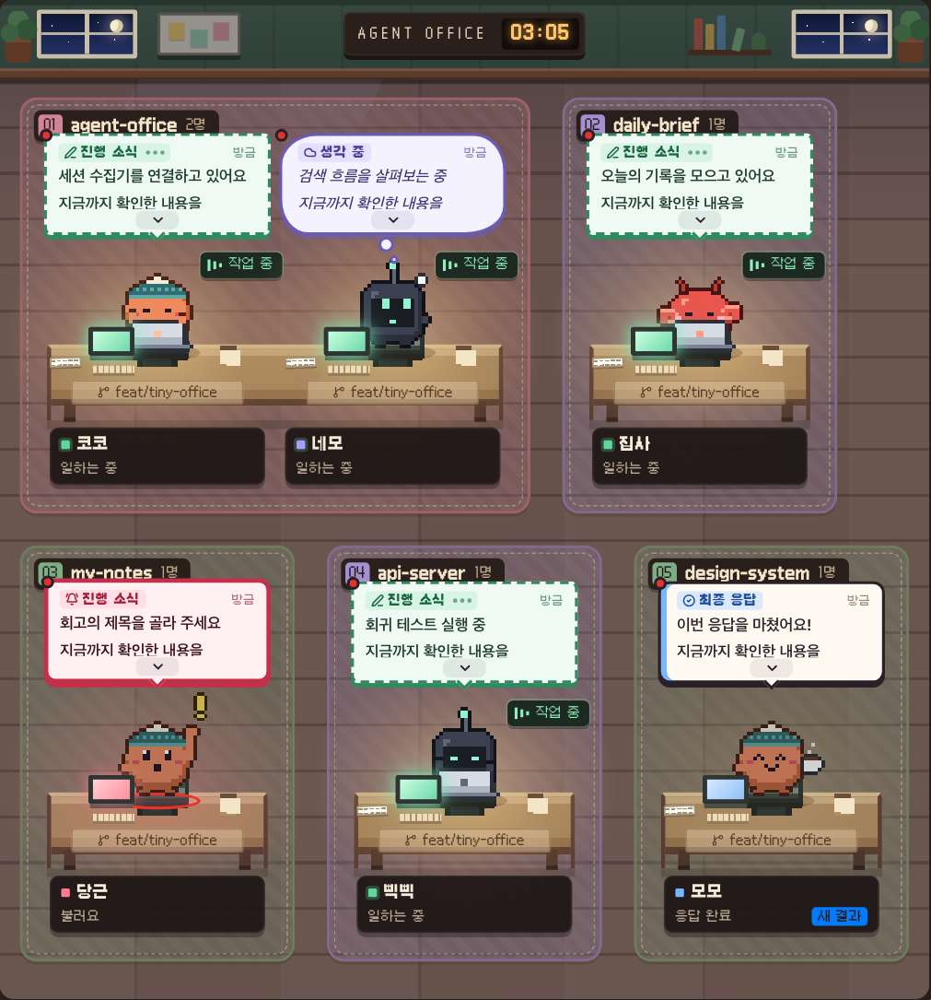
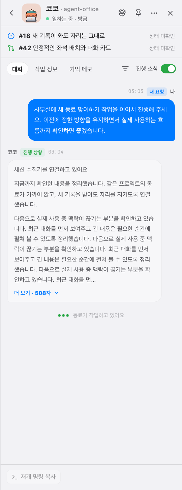
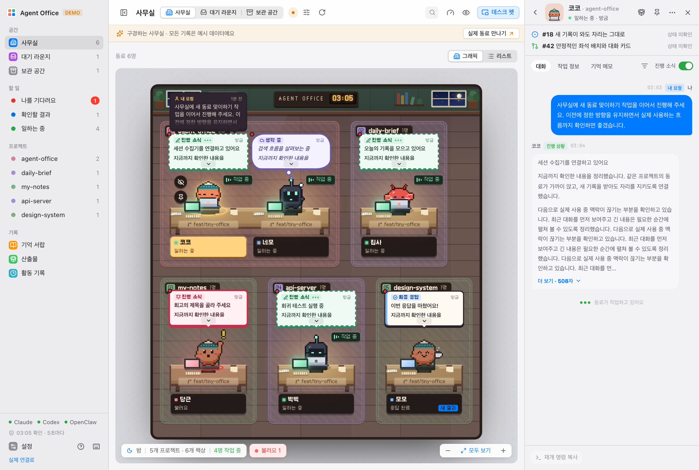

# AI는 일하는데, 왜 나는 터미널을 순찰하고 있을까

> Agent Office 제품 소개 초안. 이미지 속 세션은 합성 예시이며, 별도 브랜드 일러스트는 실제 UI가 아닙니다. 공개 릴리스 링크는 게시 직전 확인합니다.

Claude Code에는 화면 수정을, Codex에는 테스트를 맡겨두었습니다. 다른 프로젝트에서는 OpenClaw가 움직입니다. 일을 나눴으니 이제 편해질 것 같지만, 곧 창을 하나씩 열어보기 시작합니다.

누가 아직 작업 중인지. 누가 질문한 채 멈췄는지. 어느 창에 방금 답변이 도착했는지.

에이전트를 더 많이 쓴다고 확인할 일이 없어지는 건 아니었습니다. 그 확인을 조금 더 자연스럽게 만들고 싶었습니다. **Agent Office는 실제 AI 세션에 바탕화면 위 작은 책상을 하나씩 내어주는 앱입니다.**

*제품의 분위기를 표현한 AI 생성 일러스트. 실제 앱의 픽셀 동료는 아래 합성 UI 캡처로 소개합니다.*

## 세션 목록이 작은 팀이 되면

Agent Office는 Claude Code·Codex·OpenClaw가 남긴 로컬 기록을 읽습니다. 동료의 이름은 세션에서 가져오고, 프로젝트와 브랜치는 자리 배치의 단서가 됩니다.

같은 프로젝트는 같은 구역에, 같은 브랜치의 동료들은 연결된 책상에 모입니다. 보조 작업은 부모 세션과의 관계를 남깁니다. 모두를 똑같은 카드로 펼쳐 놓는 것보다, 지금 어떤 팀이 움직이는지 보기가 쉽습니다.

중요한 건 예쁜 움직임 자체보다 **그 움직임에 의미가 있는가**였습니다. 일하는 중인지, 사람의 답을 기다리는지, 새 응답이 있는지를 구분하고, 더 이상 바쁘지 않은 동료는 쉬게 합니다. 오래 조용했던 세션은 라운지나 보관 공간에서 찾을 수 있습니다.

*Agent Office 실제 UI · 이름과 대화는 합성 예시.*

## 도구 이름보다, 무슨 일을 하고 있는지

에이전트가 `exec`를 실행했다는 사실만으로는 충분하지 않습니다. 테스트를 돌리는 건지, 파일을 읽는 건지, 사용자의 답을 기다리는 건지 알고 싶습니다.

그래서 에이전트가 남긴 공개 진행 메시지를 우선 보여줍니다. 동료를 누르면 업무 카드가 열리고 **내 요청·진행 상황·최종 응답**을 나눠 볼 수 있습니다. 도구 기록이 필요하면 그때 펼칩니다. PR이나 이슈 링크도 대화에서 찾아 작업으로 연결합니다.

여기에는 별도의 모델이 만들어 낸 요약을 원래 발언인 것처럼 보여주는 과정이 없습니다. 기록에서 무엇을 읽었는지와 무엇을 확인할 수 없는지를 구분하는 쪽을 택했습니다.

*실제 업무 카드 · 합성 대화. 요청·진행·응답을 선택해 읽을 수 있습니다.*

## 사무실을 계속 열어둘 필요는 없으니까

늘 큰 대시보드를 보는 방식은 금방 부담스러워집니다. Agent Office는 화면 구석의 데스크 펫, 한 줄로 펼친 책상, 큰 사무실을 오가며 사용할 수 있습니다.

코딩하는 동안에는 작게 두고, 확인할 일이 생겼을 때 동료를 엽니다. 지원되는 연결에서는 업무 카드에서 메시지를 보낼 수도 있습니다. 전송 가능 여부는 공급자와 실행 환경에 따라 다르고, 사람의 승인까지 앱이 알아서 대신하는 것은 아닙니다.

작은 캐릭터를 보는 재미는 있지만, 사용자의 일을 가로채지 않는 게 먼저입니다. 말풍선과 새 응답 표시, 쉬는 동료의 표현도 그 기준으로 다듬고 있습니다.

*실제 책상 줄 보기 · 합성 동료.*

## 기록이 늘어도, 지금 필요한 부분부터

개발자의 세션 로그는 며칠만 지나도 꽤 커집니다. 오래된 로그 전체를 매번 화면에 올리면 작은 사무실을 위해 큰 비용을 치르게 됩니다.

최근 대화부터 읽고 이전 기록은 요청할 때 불러오는 구조, 상한이 있는 캐시, 변한 부분만 갱신하는 흐름을 사용합니다. 원본 기록과 앱의 읽음·메모 같은 사용자 상태도 구분합니다. 다만 기기·세션 수·화면 수에 따라 메모리와 CPU 사용량은 달라지므로, 특정 사용량이나 성능 배수를 모든 환경에 약속하지 않습니다.

## 내 컴퓨터를 중심으로

기본 세션 수집과 앱 데이터 저장은 로컬에서 처리합니다. GitHub 상태나 사용량 조회는 사용자가 이미 사용하는 해당 서비스와 통신합니다. 모바일 웹과 다른 사무실 연결은 별도로 켜는 기능입니다.

모바일 웹은 켜져 있는 컴퓨터에 같은 Tailscale의 기기가 접속하는 형태입니다. 서버 주소, 접속 코드, 컴퓨터의 실행 상태가 모두 맞아야 합니다. 앱이 “서버 실행 중”이라고 표시하는 것과 휴대폰에서 실제로 연결된 것은 다르므로, 연결 설정에서도 그 차이를 설명합니다.

macOS 앱 서명도 같은 맥락입니다. 안정된 앱 신원과 배포 검수에 도움이 되지만, 처음 쓰는 컴퓨터의 권한을 자동 승인하거나 다른 기기의 권한을 복사해 주지는 않습니다.

## 작은 사무실이 맡고 싶은 일

Agent Office가 맡고 싶은 일은 명확합니다. **에이전트들이 움직이는 동안, 사람이 무엇을 봐야 하는지 찾기 쉽게 만드는 것.**

실제 세션과 이름을 유지하고, 일하는 이유가 보이는 진행 메시지를 앞에 두고, 필요한 순간에 대화를 열 수 있게 만드는 일입니다. 귀여운 책상은 그 상태를 매일 보고 싶게 만드는 표현이고요.

여러 에이전트를 켜두고 창을 하나씩 순찰하고 있었다면, 작은 동료들이 모인 사무실을 한번 상상해 보세요. 바탕화면 구석에서 누군가 손을 들고 있다면, 다음에 열어야 할 창은 조금 더 분명해집니다.
