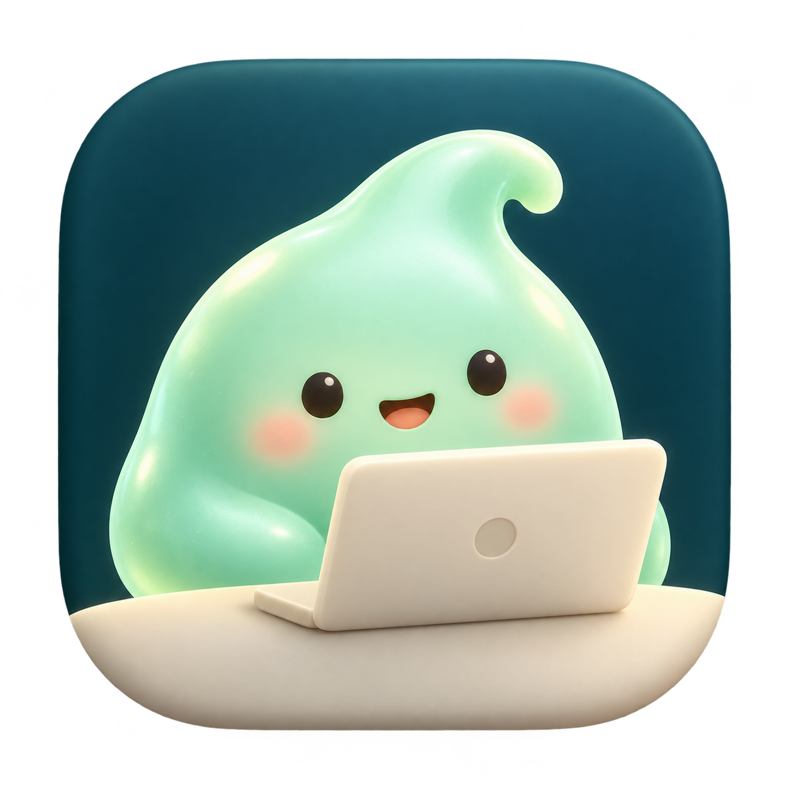

# 앱 아이콘 시안 · 2026-10-13

입체 5개와 도트 2개를 원본 PNG·생성 프롬프트·비교 HTML로 보관한다. 내장 `image_gen`으로 제작했으며, 도트 시안에는 앱의 실제 레트로 로봇 스프라이트를 스타일 참고로 사용했다.

현재 선택은 **05 · 입체 로봇 + 맥북**이다. 사용자는 현재 아이콘을 계속 쓰고 도트 시안은 후보로 보관하기로 했다. 적용 근거는 [PR125](https://github.com/kys42/agent-office/pull/125), 실제 앱 에셋은 [public/icon.png](../../../../public/icon.png)·[icon.icns](../../../../public/icon.icns)이며 [Mac 아이콘 재생성 절차](../../../development/MACOS-RELEASE.md)를 따른다.

## 입체 시안

| 01 · 개발자 고양이 | 02 · 슬라임 동료 | 03 · 작은 사무실 |
| --- | --- | --- |
|  |  |  |
| [원본 PNG](01-developer-cat.png) | [원본 PNG](02-slime-coworker.png) | [원본 PNG](03-little-office.png) |

| 04 · 미니 로봇 | 05 · 로봇 + 맥북 · 현재 사용 |
| --- | --- |
|  |  |
| [원본 PNG](04-mini-robot.png) | [원본 PNG](05-mini-robot-macbook.png) |

## 도트 후보

| 06 · A · 또렷한 도트 | 07 · B · 부드러운 도트 |
| --- | --- |
|  |  |
| [원본 PNG](06-robot-macbook-pixel-chunky.png) | [원본 PNG](07-robot-macbook-pixel-soft.png) |

## 프롬프트와 비교 화면

- [입체 01–04 프롬프트](prompts.md)
- [로봇 + 맥북 편집 프롬프트](05-mini-robot-macbook.prompt.md)
- [도트 A 프롬프트](06-robot-macbook-pixel-chunky.prompt.md) · [도트 B 프롬프트](07-robot-macbook-pixel-soft.prompt.md)
- [전체 비교 HTML](index.html) · [도트 비교 HTML](pixel.html): 다운로드하거나 아래 로컬 서버로 열면 밝은/어두운 배경과 32·64px 크기로 비교할 수 있다. GitHub에서는 이 README의 그림으로 미리 본다.
- [선택 상태·원본 해시 manifest](manifest.json) · [PNG 체크섬](SHA256SUMS.txt)

저장소 루트에서 실행:

```sh
python3 -m http.server 5190 --bind 127.0.0.1 --directory docs/research/design/app-icons-2026-10-13
```

브라우저에서 `http://127.0.0.1:5190/` 또는 `http://127.0.0.1:5190/pixel.html`을 연다. 원본 PNG는 리사이즈하지 않고 보존했다. 생성기의 로컬 절대 경로·실행 식별자는 manifest에 포함하지 않는다.
